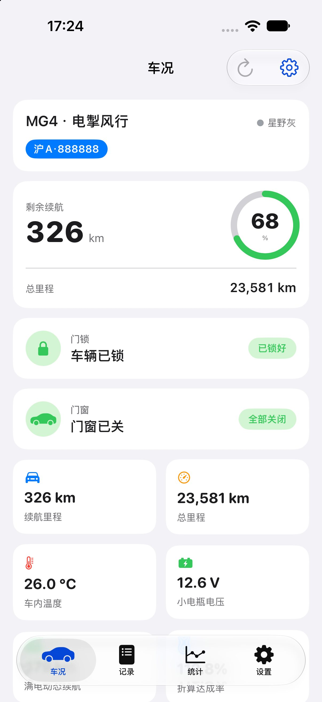
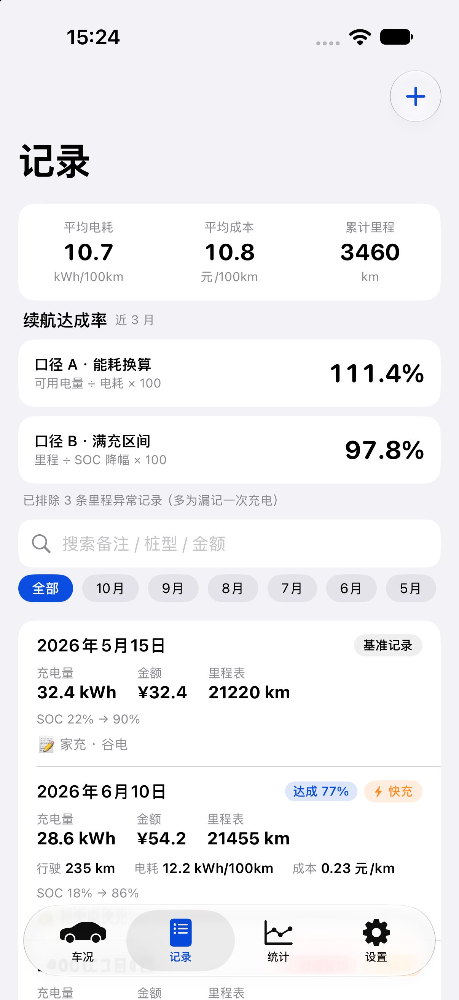
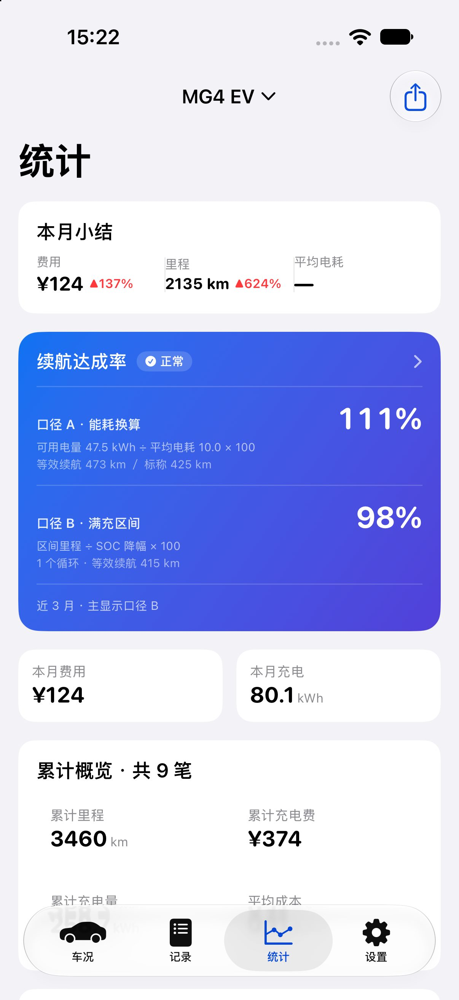
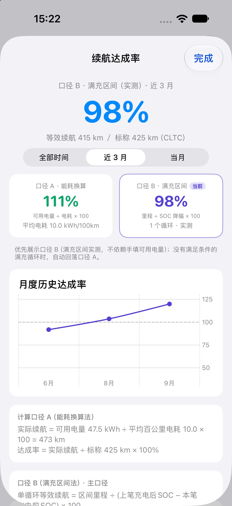
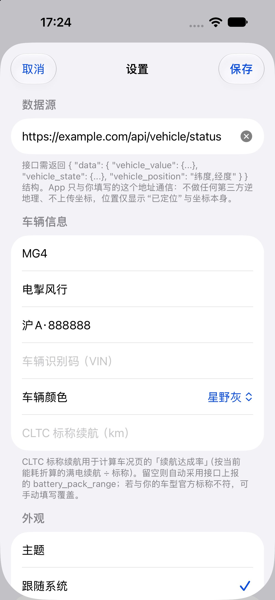
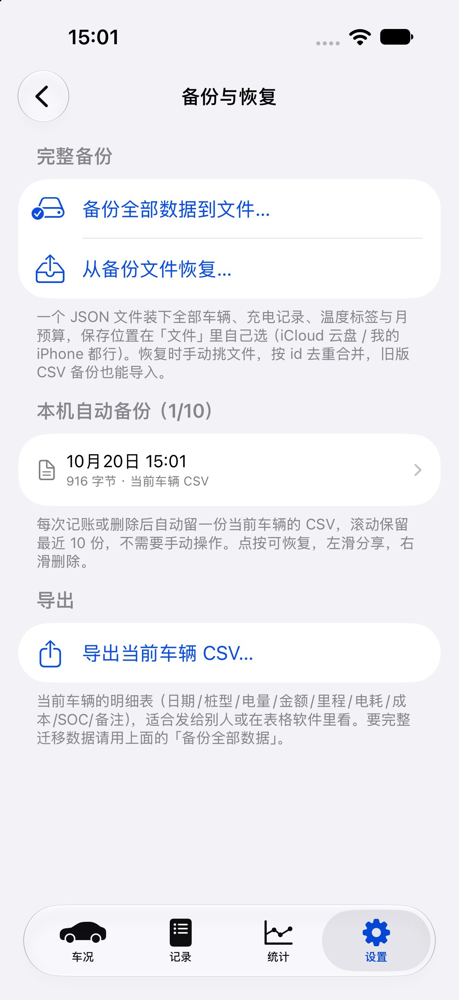
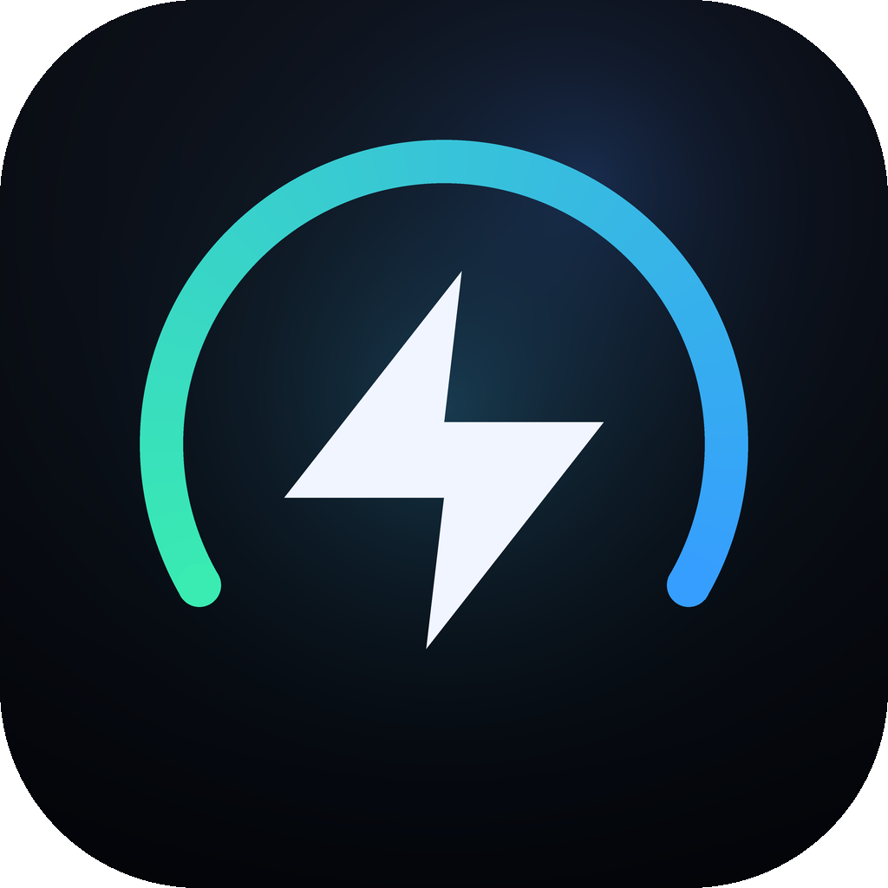

# 电车助手 —— 荣威 / 名爵 MG4 车况与电耗记录（iOS）

把 `MG4Widget 1.0.28`（车况）与 `EVLogger 1.3`（电耗助手）两个独立 App 合进一个工程、一个进程、一个图标。

面向**名爵 MG4**（以及车机接口返回同款字段结构的**荣威**车型）：一个 App 看完「车况 + 充电电耗」，数据只存本机。

- 展示名：**电车助手**
- Bundle ID：`com.evstats.EVLogger`（沿用原电耗助手，覆盖安装可保留历史记录）
- 版本：1.4 (23)，iOS 16.0+，arm64
- 目录：`mg4mate/`（工程与源码）、`dist/`（IPA 产物）

## 界面

| 车况 | 记录 |
|---|---|
|  |  |

| 统计 | 达成率详情 |
|---|---|
|  |  |

| 车况数据源 | 备份与恢复 |
|---|---|
|  |  |

> 截图里的车牌、VIN、里程、充电记录都是虚构的演示数据。

## 适用车型

- 默认按**名爵 MG4** 配置：CLTC 标称 425 / 437 km，字段取自 MG4 车机接口（`vehicle_value` / `vehicle_state` / `vehicle_position`）。
- **荣威**车型若使用同一套车机数据接口（上汽系共用字段命名），把「API 地址」指向你自己的聚合接口即可，标称续航在设置里改成对应车型的 CLTC 值。
- 车型、昵称、车牌、VIN、颜色都能在设置里改，不绑定具体车款。

> 非官方项目，与上汽、荣威、名爵无关；接口需自备。

## 名字与图标

**电车助手** —— 沿用「X 车助手」这类工具命名习惯：一眼知道是干什么的，图标下的名字也够短（四个字刚好不被截断）。功能上它同时管车况和电耗，所以取「电车」而不是「车况」，不偏向其中一半。

其他备选：**爱车助手**（更口语）、**车况助手**（偏车况）、**驭电助手**（保留品牌感）。改名字只需动 `Resources/Info.plist` 与 `Resources/Widget/Info.plist` 的 `CFBundleDisplayName`。

图标遵循 Apple HIG：

- 1024×1024 正方形、**无 alpha 通道、无圆角**（圆角由系统蒙版裁切）
- 无文字、单一主体、全出血背景，深墨蓝底 + 青色仪表弧 + 白色闪电
- 仪表弧取 240°（开口朝下），代表电量/续航表；闪电代表电耗与充电，二者共同构成「一屏看完车与电」
- 4× 超采样后 LANCZOS 缩放，60×60 下仍可辨识；生成脚本见 `tools/make_icon.py`（可改色/换弧度重出）



### 启动画面

启动画面不再放 Logo，只保留与首屏一致的纯色背景（浅色 `#F2F2F7` / 深色纯黑），由 `LaunchBackground` 颜色集随外观自动切换。这样图标缩放动画落到首屏时是无缝的，也不会再出现旧的「电耗助手」蓝底灯泡图。

> 为什么之前会闪旧启动图：合并版沿用了 `com.evstats.EVLogger` 这个 bundle id，第一版工程的 `Info.plist` 里 `UILaunchScreen` 还指向原来的 `LaunchBackground`（蓝 `#0A4DE0`）+ `LaunchLogo`（灯泡图标）。而且 iOS 会把启动图缓存成 SplashBoard 快照（App 容器 `Library/SplashBoard`），覆盖安装时不一定刷新——实测即使换掉颜色、卸载重装，旧蓝屏仍会复现，直到清掉快照或重启。
>
> 处理：本版已改背景 + 把 build 号提到 12（1.4 (12)）强制系统重建快照。装完若仍看到旧蓝屏或旧图标，TrollStore 里对 App 执行一次 **Respring**（或重启手机）即可；**不要用删除重装来清缓存**，那会连同 `EVLogger.sqlite` 一起删掉。

## 四个 Tab

| Tab | 来源 | 内容 |
|---|---|---|
| 车况 | 原 MG4Widget | 电量环、续航与 CLTC 达成率、总里程、车内温度、小电瓶电压、四轮胎压、门窗/锁止、充电状态、停车位置 + 一键导航、演示数据 |
| 记录 | 原 EVLogger | 多车、充电记录增删改、长按删除 + 撤销、搜索/月份筛选、里程表推算行驶里程、快充/慢充/家充 |
| 统计 | 原 EVLogger | 本月小结、续航达成率（口径 A/B）、累计概览、近 6 月费用/电耗/达成率图表、月报 PDF |
| 设置 | 原 EVLogger + 车况入口 | 车辆与基准、预算、统计口径、导出/备份/恢复、清除数据；新增「车况数据源与提醒」入口（接口地址、车辆信息、主题、地图修正、未锁/低电提醒） |

## 相对两个原 App 的改动

**新增的联动**

- 记录表单里新增「从车况带入里程与当前电量」按钮：读取 `CarModel.snapshot` 的 `odometer` 与 `battery`，直接填入里程表读数与「充电后 SOC」，并显示快照时间与新鲜度。
- 设置页新增「车况」分组，显示配置状态（已配置/未配置），点进即为原来的车况设置页（Form 弹层）。
- 车况页右上角齿轮与设置页入口指向同一个 `CarSettingsView`。
- 深链统一：`evstats://`、`mg4widget://` 仍可用，新增 `mg4mate://car|records|stats|settings|record`。
- 启动落点：车况已配置 → 车况 Tab；未配置 → 记录 Tab（避免首屏是空白配置卡）。

**代码层合并动作**

| 原文件/类型 | 处理 |
|---|---|
| 两个 `@main App` | 合并为 `App/MG4MateApp.swift`，`AppTab` 增加 `.car` |
| 两个 `SettingsView` | 车况侧改名 `CarSettingsView`（文件 `App/CarSettingsView.swift`） |
| 两个 `Store.swift` | 重命名文件：`Shared/Car/MG4Store.swift`（`SharedStore` 枚举）、`App/Core/EVStore.swift`（`Store` 类） |
| `enum WidgetFamily` | 改名 `MG4WidgetFamily`，避免与 WidgetKit 的 `WidgetFamily` 冲突（电耗小组件用到 `.accessoryCircular` 等） |
| 两个 WidgetBundle | 合并为 `Widget/MG4MateWidgetBundle.swift`，一个扩展挂两个 Widget |
| 两份 `SharedData` | 只保留一份 `Shared/EV/SharedData.swift`，移除 `@MainActor`（TimelineProvider 需要同步读） |
| 两个 Assets.xcassets | 合并到 `Resources/Assets.xcassets`（AppIcon 用车况的深色闪电图，AccentColor/Launch 图沿用原工程） |
| 两个 Info.plist | 合并成一个：两个 URL Scheme + `mg4mate`、文件共享、ATS、定位说明、Launch 屏 |

**刻意没动的**（保证数据与行为兼容）

- Core Data 模型、存储路径 `Documents/EVLogger.sqlite`、备份目录与原逻辑
- App Group 键：`mg4.widget` 的 `mg4.config` / `mg4.snapshot` / `mg4.history`，电耗的 `evstats.snapshot.v1` / `evstats.widgetMetric.v1`
- 车况接口 JSON 结构、GCJ-02 坐标修正、15 分钟刷新与通知冷却
- CSV 列定义、月报 PDF、备份去重规则、撤销逻辑

## 构建

```bash
cd mg4mate
xcodegen generate                           # 生成 MG4Mate.xcodeproj（brew install xcodegen）
./scripts/build_device.sh                    # Release → build-device/（内部会自动跑 xcodegen）
./scripts/package_ipa.sh                     # ad-hoc 注入 entitlements → dist/
```

`package_ipa.sh` 与「车况」1.0.28 交付包同一套流程：先给 `PlugIns/MG4MateWidget.appex` 签名，再签主 App，二者都带：

```
com.apple.security.application-groups = [group.com.evstats.EVLogger, group.mg4widget]
```

## 安装

- **TrollStore**：把 `dist/EVHelper_v1.4.tipa` 传到手机，用 TrollStore 打开安装（与车况原来的安装方式一致）。
- **普通签名服务**：用 `dist/EVHelper_v1.4.ipa` 补签。

覆盖安装时注意：

- 因为沿用 `com.evstats.EVLogger`，会**直接升级原「电耗助手」**，`EVLogger.sqlite` 与备份文件原地保留。
- 同时声明了 `group.mg4widget`，原「车况」写在 App Group 里的配置与快照也能直接读回；确认没问题后再删掉旧「车况」App（不要先删，否则该 group 容器可能被系统回收）。
- 通知权限会随新安装重新询问一次；桌面小组件需要重新添加（现在一个扩展里同时提供「车况」和「电耗」两个组件）。

## 数据备份 / 恢复

设置 → 数据 →「备份与恢复」：主页面只保留这一个入口 + 清空数据，避免四个备份按钮语义重叠。子页分三块：

| 分块 | 行为 |
|---|---|
| 完整备份 · 备份全部数据到文件… | 打包**全部车辆 + 记录 + 温度标签 + 月预算**为一个 JSON（`电车助手_备份_yyyyMMdd_HHmm.json`），弹出系统「文件」面板，保存位置自选 |
| 完整备份 · 从备份文件恢复… | 手动挑文件；JSON 按 id 去重合并，旧版 CSV 备份也能导入 |
| 本机自动备份（n/10） | 每次记账/删除后自动留一份当前车辆 CSV，滚动 10 份；点按恢复、左滑分享、右滑删除 |
| 导出 · 导出当前车辆 CSV… | 明细表，走系统分享面板，适合发人或进表格 |


实现：`App/Core/BackupService.swift`（备份结构 + `DocumentGate` 直连 `UIDocumentPickerViewController`）、`Store.makeFullBackup()` / `restoreBackup(from:)` / `autoBackupFiles()`。

## 续航达成率口径

一个数字三个页面，口径必须统一，否则会出现「记录页 115%、统计页 196%」这种自相矛盾：

统计页与记录页**上下分开、先 A 后 B**，每块都写清换算方式：

| 顺序 | 口径 | 卡片上写的公式 | 说明 |
|---|---|---|---|
| 先 | A · 能耗换算 | 可用电量 ÷ 平均电耗 × 100，再 ÷ 标称 | 两笔记录即可算，但「可用电量」是手填值，填错会整体偏移 |
| 后 | B · 满充区间（实测） | 区间里程 ÷ SOC 降幅 × 100，再 ÷ 标称 | 只用两个实测量，不依赖手填值；要求上一笔充到 ≥90% 且本笔记录了充电前 SOC |

- 统计卡：标题 → 分隔线 → A 块（数值 / 公式 / 等效续航）→ 分隔线 → B 块（数值 / 公式 / 循环数）→ 分隔线 → 窗口与主显示口径。
- 记录页：A、B 各自一张卡（标题 / 公式 / 数值），卡片之间留空，下面是排除记录提示。
- 详情页：两张对照卡**先 A 后 B**，各带公式；实际采用的口径标「当前」并高亮描边。
- 车况页「折算达成率」是另一个东西：满电动态续航（当前续航 ÷ 电量 × 100）÷ CLTC 标称，属于瞬时折算。

**数据清洗**（否则漏记一次充电就能把达成率抬到 200%）：

- 里程回退（本次读数 < 上次）判为录入错误，**保留原基准**，不把基准改小，避免下一笔里程被虚增
- 隐含电耗不在 5–40 kWh/100km 的区间判为不可信，排除出电耗/达成率聚合，卡片标「⚠ 数据异常」，页面注明「已排除 N 条」
- 「本月里程」用全部有效里程，「平均电耗」只用可信区间，两者不互相拖累

## 修复记录

- **1.4 (22)**：记录页「续航达成率」拆成 A、B 两张卡；设置 →「车况数据源」的 API 地址增加一键清除按钮（有内容时才出现）。

- **1.4 (21)**：达成率卡片改为上下分块，先口径 A 后口径 B，每块各自注明换算公式与结果；记录页同样改为 A、B 两行；详情页对照卡调整为先 A 后 B。

- **1.4 (20)**：达成率改为 A / B 并列展示，两列各自注明换算公式与样本；记录页同步显示两个值；详情页对照卡加公式行。

- **1.4 (19)**：达成率默认改为主显口径 B（满充区间实测），样本不足回落口径 A；卡片与详情页标明当前口径、循环数，并给出另一口径作对照；详情页 B 卡置前并加「当前」标记。

- **1.4 (18)**：按「分开排版」重做两处卡片。车况页拆成两张卡：`身份卡`（车型·昵称 / 车身颜色 / 车牌 / VIN）+ `能量卡`（剩余续航 36pt + 电量环右置，分隔线，总里程）。统计页达成率卡改为三段：标题与状态 / 环形 + 估算续航与标称 / 分隔线 + 口径说明。

- **1.4 (17)**：重排两处核心卡片。① 车况主卡改为「身份 → 车牌 → 电量环+续航 → VIN 脚注」四段式，VIN 不再挤在右列、颜色挪到标题行右侧、续航数字放大到 30pt，左右留白对齐。② 统计页达成率卡压缩成三行：标题+状态徽章 / 估算 vs 标称 / 单行口径说明，去掉卡片里的「已排除 N 条」等细节（详情页保留），环形指示器缩到 84。

- **1.4 (16)**：续航达成率审查与修复。① 记录页原先用「里程 ÷ 标称」求平均，与统计页口径 A 完全不是一个概念，且对部分充电周期无意义；现统一为口径 A + 同一统计窗口，两页数字一致。② 每笔卡片改显示口径 B 单周期达成率。③ 修正里程回退时基准被改小、导致下一笔里程虚增的问题。④ 口径 B 不再漏掉第一个满充周期。⑤ 增加隐含电耗合理性校验（5–40），排除漏记造成的假低电耗，并在页面标注排除条数。⑥ 车况页指标改名「折算达成率」，与统计口径区分。

- **1.4 (15)**：备份入口合并。设置页「数据」只留「备份与恢复」一项，完整备份 / 手动恢复 / 本机自动备份 / CSV 导出都收进子页；本机自动备份从"看不见"变成可浏览、可恢复、可分享的列表。

- **1.4 (14)**：备份改为「导出完整 JSON 并自选保存位置」，恢复改为「手动选文件」；新增全量备份结构（含多车、温度、预算），旧版 CSV 备份仍可导入。
- **1.4 (13)**：修复「导出 / 分享 CSV」点开是纯白空面板。原因是把 `UIActivityViewController` 当作 SwiftUI `.sheet` 的内容（`UIViewControllerRepresentable`），新系统上会渲染成空白；改为 `App/Core/SharePresenter.swift` 从最上层 `UIViewController` 直接 present。月度报告 PDF 走同一路径，一并修好。CSV 与月报 PDF 的文件名、PDF 页眉、预算提醒标题一并改回「电车助手」品牌。
- **1.4 (12)**：显示名改为「电车助手」；启动图去掉旧 Logo，改为与首屏同色的纯背景。
- **1.4 (11)**：修复启动图仍是旧「电耗助手」蓝底灯泡（build 号提升强制重建 SplashBoard 快照）。

## 调试参数（仅 Debug 构建）

```bash
xcrun simctl launch booted com.evstats.EVLogger -tab car -demo -seedrecords
```

- `-tab car|records|stats|settings`：指定启动 Tab
- `-demo`：车况载入演示快照
- `-seedrecords`：写入示例车辆 + 8 条充电记录（仅在库为空时）
- `-newrecord`：启动后自动弹出「记一笔充电」
- `-exportcsv` / `-exportpdf`：启动后自动触发 CSV / 月报 PDF 导出，用于验证分享面板
- `-backup`：启动后自动弹出「备份到文件」选择器
- `-restoretest`：用当前库自造一份备份再导入，验证去重（应全部跳过）
- `-restorefile <文件名>`：读取沙盒 `Documents/<文件名>` 的备份并恢复
- `-wsmall` / `-wmedium` / `-wlarge` / `-wlock`：全屏放大渲染小组件布局（自检用）

## 后续可以做的

1. 车况配置里的「API 地址」可以接到自建的车辆接口，省掉手动填写。
2. 充电中状态 → 自动提示记账；充完电按 SOC 差值预填充电量。
3. 车况页与统计页共用一套「续航达成率」口径（目前车况用 CLTC 标称、统计用口径 A/B）。
4. 换一个合并版专属图标（现在是车况原图标）。

## 隐私与数据

- **没有账号体系，没有云端**：所有数据只写在本机（Core Data + App Group 缓存），不登录、不上传、无统计 SDK。
- **不访问任何第三方接口**：App 只与你填写的「车辆数据接口」通信；开源版已移除高德逆地理与远端车图下载，坐标不外发。
- **不申请定位权限**：位置只用来在地图上画车辆标记，不读取你的位置。
- **唯一的系统权限**是本地通知（未锁/低电/预算提醒），可在系统设置里随时关闭。
- 仓库内不含任何真实车牌、VIN、账号或密钥；截图与演示数据均为虚构。

## 许可证

[MIT](LICENSE)

## 免责声明

本项目是个人自用的车况/电耗记录工具，与上汽、名爵（MG）及其关联公司无关，也未获得其授权或背书。
「车辆数据接口」需要你自己提供并保证合法合规；因使用本软件产生的任何后果由使用者自行承担。
